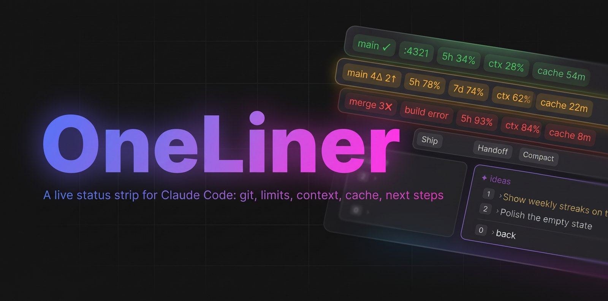
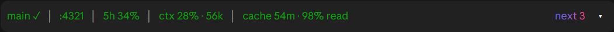
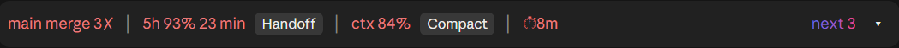
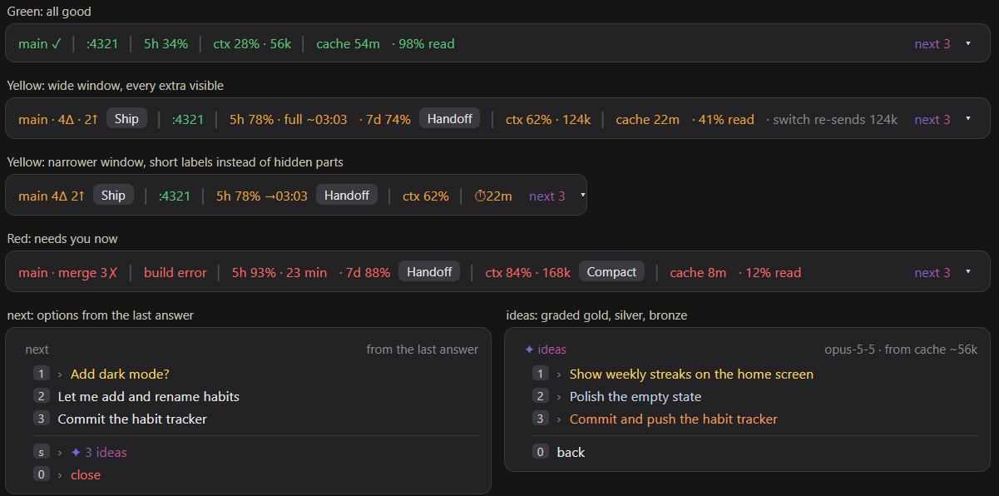
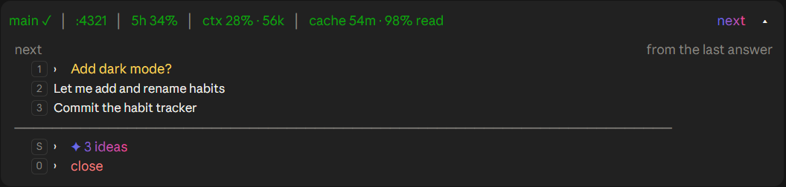
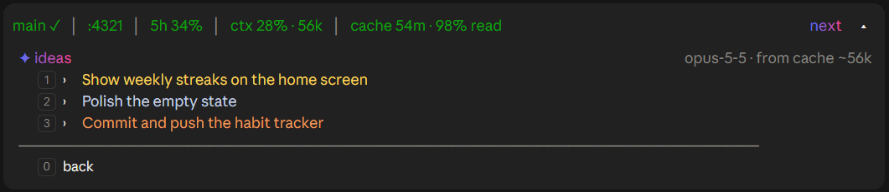

# OneLiner

**A calm instrument strip for Claude Code: 5-hour limit with forecast, prompt-cache countdown, context fill, git changes and ship, helper agents, prompt upgrade, a work report, and next-step ideas - in one line above your prompt.**

[](https://github.com/deadraw/OneLiner/releases/latest)
[](LICENSE)
[](#install)






### Quick install

In Claude Code:

```
/plugin marketplace add deadraw/OneLiner
/plugin install oneliner@deadraw
```

Restart Claude Code. To get new versions automatically, turn on auto-update ([how](#from-the-marketplace-recommended)). [Full install notes ↓](#install)

---

## Why

Working with Claude Code all day, the same things keep costing time:

- **You hit the 5-hour limit in the middle of a task**, and the prompt you just sent is lost.
- **The prompt cache goes cold silently.** After an hour of inactivity, your next message re-sends the whole conversation at full price, and nothing tells you.
- **You lose track of git**: what's committed, what's pushed, whether a teammate (or another agent) pushed in the meantime.
- **Context fills up**, compaction happens, and you have to explain where you left off again.

**OneLiner** puts all of it in one line: green while everything is fine, yellow when it's getting tight, red when something needs you now.

## The strip



| Segment | Shows | 🟢 | 🟡 | 🔴 |
|---|---|---|---|---|
| **git** | branch, changed files (Δ), unpushed (↑), behind (↓) | clean and pushed | changes not shipped / behind (**▴** opens the changes panel with **Ship**) | merge conflict, rebase stopped halfway, diverged |
| **dev** | your local dev server | running | - | build error (gray when off, + **Start**) |
| **⇡ upgrade** | turns the prompt you are typing into a better one, in a side pane ([more ↓](#prompt-upgrade)) | - | - | - |
| **◈ agents** | helpers Claude runs for this task: how many are working, or the number you set (`◈ 3`) | helpers working | - | - |
| **5h limit** | 5-hour usage, forecast, reset time | ≤ 70% | 71–85% | ≥ 86% (+ **📝** handoff, once ctx is 25% or more) |
| **ctx** | context window fill and tokens | ≤ 49% | 50–70% | ≥ 71% (+ **Handoff** and **Compact** buttons) |
| **cache** | minutes until the prompt cache expires · % of the last turn read from cache | ≥ half the lifetime left | 25–50% left | < 25% left, cold, or reset (+ **Compact** from 30% context) |
| **next** | options from Claude's last answer + ideas on request | | | |

Extras that appear only when relevant:

- `· full ~16:40`: at your recent pace, the 5-hour window fills before it resets.
- `· 7d 74%`: the weekly window, shown from 70%.
- `· switch re-sends 306k`: what a `/model` switch would throw away (wide strip, warm cache, large context).
- `cache reset · effort`: you changed effort, thinking or fast mode, which empties the conversation cache.

### Hover for details

In the desktop app, point at any part of the strip to see more, written into the same line (the parts to its right slide over while you hover):

| Part | Hover shows |
|---|---|
| **git** | one changed file with its lines (`register.tsx +12 −3`), or how many and their lines (`4 edits +43 −18`); the last commit's files and age (`last: handoff.md, problem.c · 7m ago`) |
| **dev** | the server address, or the full build error; while it runs, **■** stops it and **↻** restarts it (whoever started it: **Start**, Claude or a terminal) |
| **5h limit** | reset time, fill forecast, weekly window, what this conversation has cost at API prices (`$2.43`, kept across restarts and resumes), and `↑ 3 agents` while helpers are using it |
| **ctx** | free space and window size, with **📝** (handoff) and **♻️** (compact) at any fill level |
| **cache** | when it expires if you stay idle, and its lifetime |

Token counts read the way you'd say them: `482k`, `1M`, `1.2M`.

### Changes

**▴** before the branch opens the changes panel, in the same place as `next`. While it is open, git's hover detail stays shown on the strip, and **changes ▾** in the strip's top right corner closes it. **▴** and dev's **Start** sit before their text, so pointing at them doesn't open the hover.

- every changed file with its lines added and removed (`new` or `binary` when there are none to count); pick one (or press 1-9) to see its diff in a pane, with **‹ Previous** / **Next ›** through the rest
- the commits waiting to push
- **Ship**, **+68 −31** (the whole diff, file by file) and, on a branch other than `main`, **Create PR**: asked in a row under the strip as **Create** or **Draft**, it pushes the branch if needed and opens the pull request with the GitHub CLI (`gh`), its title and description written from the commits. Without `gh`, the request is put in the prompt for Claude.

### Agents

**◈** on the right opens the agents panel: how many helper agents Claude may use for your **next task**, and on which model.

- **helpers**: **Auto** (Claude decides, as without OneLiner), **1 3 5 10 15 20**, or **Custom** with a **− N +** stepper from 1 to 20.
- **model**: **Same model**, or **Fast & cheap**: one model below yours (Opus → Sonnet, Sonnet → Haiku), for helpers whose call names no model.
- Every helper of the task gets a colored row with what it does, how long it has worked, and ✓ when done (✕ when it failed).

With a number set, Claude is asked to split the task into up to that many parallel helpers where the work really splits, never padding it with work that isn't needed. A helper past the number is refused with a reason, and Claude carries on with the ones it has; helpers started by helpers count too.

The setting is for one task: once an answer that used helpers is done (and they are all back), it returns to **Auto** and **Same model**. An answer without helpers, such as a question back to you, keeps it. Every new session starts on Auto, and **Back to Auto** resets it by hand. `◈ ▾` closes the panel; it stays open while you send, so you can watch the helpers work.

### Prompt Upgrade

**⇡**, left of **◈**, takes what you have typed in the prompt box and turns it into a clearer prompt, in a side pane:

1. **Questions**: up to three quick multiple-choice questions that would most improve the result, as chips, each with **Other** (type your own) and **Skip**; **Skip the rest, upgrade now** goes straight on. When no question would help, it skips to the rewrite.
2. **Rewrite**: your prompt with a clear goal, who it is for, the format and what "done" looks like. It keeps what you meant, uses only what you answered, and never invents facts, names or numbers: anything unknown stays as a `[placeholder]`.
3. **Review**: words before and after and how many details were added, then **Use it**, **Try again** or **Cancel**, the list of what was added, and your prompt beside the upgrade.

**Use it** puts the upgrade in your prompt box. Nothing is sent until you press Enter. While the cache is warm the questions and the rewrite are asked over the cached conversation, so they know what you are working on; otherwise Claude Sonnet answers on a short digest. The pane shows which one ran. `/strip upgrade` hides the button.

On a narrow window the strip first drops the optional extras (switch hint, `% read`, `7d`), then switches to short labels (`main 4Δ 2↑`, `5h 78% →03:03`, `⏱22m`), and only then drops whole parts: **dev**, **git**, **ctx**. **Limit** and **cache** always stay, and so does **dev** while it offers **Start**.

## The next list

Click **`next ▴`** to open a short list above the prompt:

<p>
  
  
</p>

- **1–4**: the options Claude offered at the end of its last answer, shortened to one line. Free: no model call.
- **s ✦ 3 more ideas**: three new suggestions written the way you would ask, graded **gold / silver / bronze** by how much they move your current goal forward.
  - While the cache is warm, they're asked over the cached conversation (cheap).
  - When the cache is nearly gone (under 10% of its lifetime left) or cold, or your 5-hour limit is at 80% or more, Claude Sonnet answers on a short digest instead.
  - Generated at most once per turn.

Picking an item fills your prompt box. Nothing is sent until you press Enter.

**▤ report** (or **r**) at the bottom of the list opens the work report.

## Work report

`/report` (or **▤ report** in the next list) opens a pane with what Claude did for you, from real numbers only:

- **Today / Week / Month / Year** tabs.
- **AI TIME**: how long Claude worked on your prompts. **SESSIONS**: how many sessions had turns. **API PRICE**: what the same tokens would have cost at API prices, from Claude Code's own cost figures.
- **~ cache saved**, the one estimate: what the prompt cache took off the bill, from the API's price ratios. Then tasks (prompts you typed that got an answer) and tokens.
- **WHO DID THE WORK**: the share per model, helpers included. **WHERE IT WENT**: the share per project.
- **Tasks / Tokens**: the rows count tasks (with the price per model) or tokens. Tokens are kept per model and project from 1.0.10 on; for earlier days a day's total is split by its tasks, marked **~** where several models or projects shared that day.
- A chart of AI time per day (per month for the year), today in gold, and your streak of active days.

It counts from the moment you install 1.0.8; nothing before that is known. The figures are kept on your machine in Claude Code's mod store, one entry per day. Running `/report` again closes it.

## Commands

| Command | Does |
|---|---|
| `/ship` | Commit (and optionally push). Runs your build first, writes the commit message, asks before pushing. Refuses during a conflict. |
| `/handoff` | Writes or updates your `CURRENT.md` / `HANDOFF.md` from the conversation, keeping its structure; any conversation works, coding or not. A row under the strip asks **Write** / **Cancel**, then offers **Clear & continue** (clears the chat; Claude reads the handoff, tells you where you left off and proposes next steps, then waits for you), **Clear**, or **Not now**. Keeps a backup of the previous file. Also on the **Handoff** button (red ctx), **📝** beside the 5h limit (near the wall, once ctx is 25% or more) and **📝** in the ctx hover. |
| `/limits` | A chart of the current 5-hour window: usage so far, pace, forecast, reset time, weekly window. Run it again to close it. |
| `/report` | The work report: AI time, sessions, API price, cache saved, models and projects, by day, week, month or year. Run it again to close it. |
| `/brief` | Where you left off in this project: **Goal**, **Done** and up to three **Next** steps, each on its own line in full and one click (or key 1-3) into the prompt box; plus branch, unpushed and changed files and the last commit. Also opens by itself after 6+ hours away and after a compaction. |
| `/strip` | Turn strip parts on or off (`/strip cache`, `/strip agents`, `/strip upgrade`, `/strip all`). Saved for all projects. |
| `/strip agents 5` | Up to 5 helpers for the next task (1-20); `/strip agents auto` goes back to Auto. |
| `/strip demo green` | Sample values for screenshots: `green`, `yellow`, `red`, `next` (the list open), `ideas` (graded ideas), or `play` to loop through all of them for a screen recording. Buttons are off and nothing is spent; `/strip demo off` returns to your real values. |

## Popups (only when they matter)

- 5-hour limit at 90%, or the forecast says full within 30 minutes.
- A limit or credit error stopped your prompt: **switch model & resend**, or **resend at reset**.
- Someone else pushed to your branch: "*Alex pushed 2 commits to main - pull before you continue*".
- Your dev server rebuilt (or broke) after Claude edited files.
- A `/model` switch is about to drop a large warm cache.

## Install

Requires **Claude Code 2.1.286 or newer** (mods / function hooks).

### From the marketplace (recommended)

```
/plugin marketplace add deadraw/OneLiner
/plugin install oneliner@deadraw
```

Or from a terminal: `claude plugin marketplace add deadraw/OneLiner`, then `claude plugin install oneliner@deadraw`. Restart Claude Code and the strip appears after your first message.

**Updates.** Claude Code leaves auto-update off by default for marketplaces outside Anthropic's own. To get new versions when Claude Code starts, turn it on:

- **Terminal:** `/plugin` → Marketplaces → **deadraw** → Enable / Disable auto-update.
- **Desktop app** (or by hand): in `~/.claude/settings.json`, set `"autoUpdate"` to `true` or `false`:

```json
"extraKnownMarketplaces": {
  "deadraw": {
    "source": { "source": "git", "url": "https://github.com/deadraw/OneLiner.git" },
    "autoUpdate": false
  }
}
```

With auto-update off, update by hand (the desktop app's Plugins page has an **Update** button too):

```
/plugin marketplace update deadraw
```

### Manual (git clone)

```bash
git clone https://github.com/deadraw/OneLiner ~/.claude/mods/OneLiner
```

Then load it in every session by adding this to `~/.claude/settings.json`:

```json
{
  "env": {
    "CLAUDE_CODE_PLUGIN_DIRS": "~/.claude/mods/OneLiner"
  }
}
```

If you already load other plugin folders, separate the paths with `;` on Windows and `:` on macOS/Linux. Restart Claude Code (desktop app or terminal). Update later with `git pull` in that folder. Use one install method, not both.

To try it for one session only:

```bash
claude --plugin-dir ~/.claude/mods/OneLiner
```

## How accurate is it?

The numbers come from Claude Code itself, not estimates:

| Value | Source |
|---|---|
| 5h / 7d limit % | the rate-limit reading on each API response |
| ctx % and tokens | the same figures as Claude Code's own status line |
| % read | cache-read ÷ total input tokens of the last turn, as reported by the API |
| cache lifetime | 1 hour on subscription sessions, 5 minutes in extra usage; switched automatically, and taken from Claude Code when it reports it (model switch, resume) |

The cache clock starts at the **start** of the last request, which is how the API measures it, and resets on a model switch, compaction, or an effort / thinking / fast-mode change.

Measured across ~6,900 requests from real sessions, by the gap since the previous request:

| Gap | Read from cache |
|---|---|
| under 5 min | 97.7% |
| 5–55 min | 92.2% |
| 65 min or more | **0%** |

That cliff after one hour is what the cache segment counts down to.

The **limit forecast** is an estimate: a straight line through the last 30 minutes of readings. Treat it as an early warning, not a promise.

## What costs tokens

Almost nothing. Everything on the strip is read from data Claude Code already has.

| Feature | Cost |
|---|---|
| The strip, popups, `/limits`, `/strip`, options from the last answer | free |
| `/brief` | free after a compaction (it reads the fresh handoff note); otherwise one short Claude Sonnet call, reused until you send something new |
| `✦ 3 more ideas` | one small question; cheap from a warm cache, a few thousand Claude Sonnet tokens otherwise |
| `/handoff` | one question over the cached conversation, plus writing the file |
| `/ship` commit message | one short Claude Sonnet call |
| **Create PR** title and description | one short Claude Sonnet call |
| Changes panel and diff pane | free |
| **⇡** Prompt Upgrade | one question for the questions and one for the rewrite (plus one per **Try again**); cheap from a warm cache, a few thousand Claude Sonnet tokens otherwise |
| `/report` | free: it adds up what each turn already reported |
| Agents panel and its setting | free. The helpers themselves are Claude working: each runs its own context, so several at once use your limit faster. **Fast & cheap** runs them one model below yours |
| Handoff note before compaction (`.claude/handoff.md`) | one question over the cached conversation, once per compaction (Claude Sonnet when there is nothing cached yet) |

## Privacy and what it runs

No telemetry and no services of its own: nothing leaves your machine except through Claude Code itself. Everything OneLiner runs, reads or writes:

| What | When |
|---|---|
| `git` in your project, including a background `git fetch` every 5 minutes (downloads, never changes your files) | always, in a git project |
| your build (`npm run build`, or `gradlew assembleDebug` in an Android project) | before a `/ship` commit, when `SHIP_BUILD` is on |
| your dev command (from `.claude/launch.json`, with its `env`, else `npm run dev`) | when you press **Start** |
| `netstat -ano` and `taskkill /PID <pid> /T /F` on Windows, `lsof` and `kill` elsewhere, on the process listening on your dev port | when you press **■** or **↻** |
| an HTTP request to `http://localhost:<your dev port>/` | to show whether the dev server is up |
| `gh` (the GitHub CLI): `gh --version`, `gh pr view`, `gh pr create` | when you press **Create PR** |
| model calls through your own Claude Code session (listed in [What costs tokens](#what-costs-tokens)) | only from the features in that table |
| handoff files in your project (with a backup of the previous one), and `.claude/handoff.md` before a compaction | when you ask, and before a compaction |
| the work report's daily totals, the conversation cost and the last limit reading, in Claude Code's local mod store | after each turn |

It never changes your permission settings, never writes Claude Code's settings files and never reads credentials. `git fetch`, `git push` and `gh` sign in the way you already set them up (your git credential helper, `gh auth`); OneLiner doesn't see those logins, and they only reach your own repository's remote.

### What it does inside Claude Code

**Slash commands it runs for you**, only from a button you press:

| Command | When |
|---|---|
| `/clear` | **Clear & continue** or **Clear** after a handoff is saved |
| `/compact` | **Compact** (red ctx or a cold cache) and **♻️** in the ctx hover |
| `/model <model>` | **Switch model & resend**, after a limit or credit error stopped your prompt |

**Prompts it sends for you**, only after you pick them:

- **Clear & continue**: one prompt, as you, after the clear: *Read ./HANDOFF.md (your handoff file) and then tell me briefly where we left off and propose the next steps. Don't start any work until I confirm which step to take.*
- **Switch model & resend** and **Resend at HH:MM**: the prompt of yours that the limit stopped, unchanged.

Everything else that goes into your prompt box (next options, ideas, the brief, Prompt Upgrade) is only filled in. You send it with Enter.

**What its model calls read.** `/brief`, ideas, `/handoff`, the handoff note before a compaction, commit messages, Create PR texts and Prompt Upgrade ask Claude a question through your own session. They either go over the cached conversation (a fork of it) or to `SMART_MODEL` with a short digest of your recent prompts, Claude's last answer, your handoff file and `git status`. The answers are shown to you or written to the handoff file; nothing goes anywhere else.

**Files it writes**: your handoff file (`HANDOFF.md`, `CURRENT.md` or the one you already use) and a backup of its previous text, both only after you press **Write**, and `.claude/handoff.md` before a compaction. Claude reads these files when you continue from a handoff, so they are instructions for the next session: they hold what the conversation said, nothing else.

**Hooks**, and what each does:

| Hook | What it does |
|---|---|
| `prompt.submit` | Notes the prompt for the report and the next list. With a helper number set in the **◈** panel, it adds one line beside your prompt telling Claude to use at most that many helpers. Your text is never changed. |
| `agent.spawn` | With a helper number set, refuses a helper past it (with a reason Claude reads). With **Fast & cheap**, gives a helper whose call names no model the model one below yours. On **Auto** it changes nothing. |
| `turn.complete`, `turn.step`, `session.append`, `tool.call` | Read only: timings, tokens and costs for the strip and the report, Claude's last answer for the next list, a limit error for the resend offer, and whether files were edited (for the dev rebuild check). |
| `command.run`, `config.set` | Read only: notice `/effort`, `/fast` and thinking changes, which empty the conversation cache. Its own commands (`/ship`, `/handoff`, `/limits`, `/report`, `/strip`, `/brief`) are registered here. |
| `session.compact` | Writes `.claude/handoff.md` before a compaction and opens the brief after it. The compaction itself is unchanged. |
| `session.start`, `session.attach`, `classic.SessionStart`, `classic.PreModelSwitch`, `classic.PostModelSwitch` | Read only: start the strip, restore the cache clock on resume, warn before a model switch drops a warm cache. |
| `ui.render` | Draws the strip above the prompt and its panes. |

## Customize

Everything tunable is a named setting at the top of [`hooks/register.tsx`](hooks/register.tsx):

| Setting | Default |
|---|---|
| `LIMIT_YELLOW_PCT`, `LIMIT_RED_PCT`, `LIMIT_WARN_PCT` | 71, 86, 90 |
| `CONTEXT_YELLOW_PCT`, `CONTEXT_RED_PCT` | 50, 71 |
| `CACHE_GREEN_SHARE`, `CACHE_RED_SHARE` | 0.5, 0.25 |
| `CACHE_COMPACT_MIN_PCT` | 30: below this context fill, a cold cache gets no Compact button (re-sending is cheaper) |
| `GRADE_COLORS` | gold `#F7D35C`, silver `#C4D3E6`, bronze `#EE9D5B` |
| `GRADE_STYLE` | `'text'` (colored text) or `'dot'` (colored ●) |
| `IDEAS_FROM`, `IDEAS_TO` | the `next` gradient, `#6a6ae4` → `#e34a9e` |
| `SHIP_BUILD` | `true`: build before committing |
| `SMART_MODEL` | `claude-sonnet-5-5` (effort low): the brief, the handoff note, commit messages, pull request texts, ideas off the cache |
| `IDEAS_SMART_LIMIT_PCT`, `IDEAS_SMART_CACHE_SHARE` | 80, 0.1: when ideas switch from the cached conversation to `SMART_MODEL` |
| `BRIEF_GAP_HOURS` | 6 |

Handoff files are looked for at `.claude/handoff.md`, `Current.md`, `CURRENT.md`, `HANDOFF.md`, `handsoff/CURRENT.md`, `handoff/CURRENT.md` and `docs/handoff.md`; the most recently edited one wins.

## Limitations

- Mods are an **early-access** Claude Code API and may change between releases.
- Claude Code buttons can't be colored, so colored rows are clicked on the small `›` next to them (or with their number key).
- Switching fast mode or thinking with a **keyboard shortcut** may not be reported to mods; the low `% read` on the next turn still shows the cache was rebuilt.
- The 5-minute cache in extra usage is detected from the limit reading (≥ 100%).
- Mods do not run in WSL sessions. In VS Code the strip needs the extension at 2.1.299 or newer.
- Developed and used on Windows. macOS and Linux should work; reports welcome.

## License

[MIT](LICENSE) © deadraw
